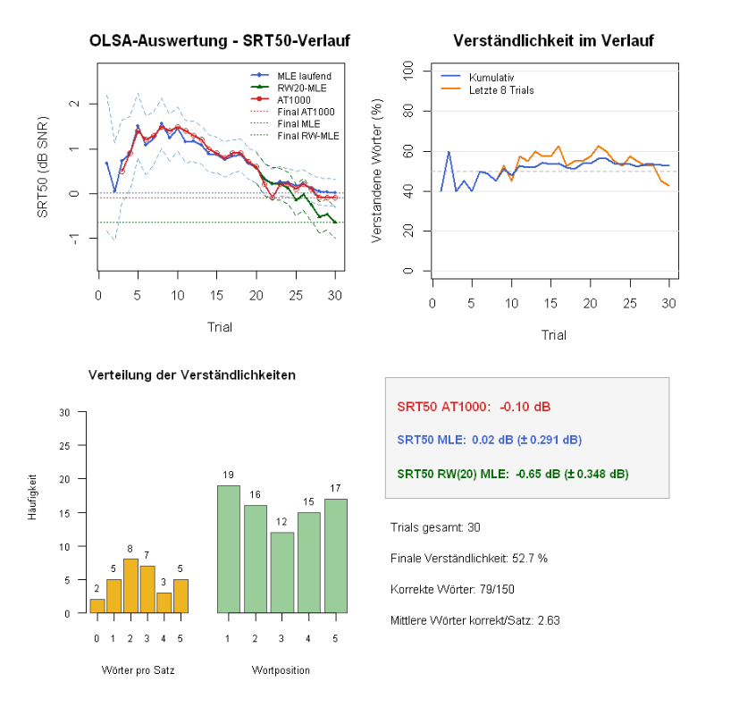

# rAT1000

An R package for importing, analyzing, and visualizing OLSA (Oldenburg Sentence Test) measurements recorded with the AT1000 audiometry system.

The package reads AT1000 `.hd` files, extracts trial-level word recognition and measurement metadata, and independently estimates the speech reception threshold at 50% intelligibility (SRT50) using a fixed-slope maximum-likelihood estimator (MLE).

## Installation

Install directly from GitHub:

```r
install.packages("remotes") # only if not already installed
remotes::install_github("k-andyman/rAT1000", upgrade = "never")
library(rAT1000)
```

To reinstall an updated version:

```r
remotes::install_github("k-andyman/rAT1000", force = TRUE, upgrade = "never")
```

## Usage

### Process an AT1000 measurement

```r
result <- process_olsa("measurement.hd")

result$global  # Measurement metadata and AT1000 results
result$trials  # Trial-level data and cumulative MLE results
```

The package uses the following defaults:

```r
result <- process_olsa(
  "measurement.hd",
  slope = 0.15,
  trim_aborted = TRUE,
  min_zero_run = 5
)
```

The output is a list containing two data frames:

- `global`: AT1000 measurement metadata, reported results, and information about any removed trailing trials.
- `trials`: Retained trials, including SNR, word recognition, and the additional columns `SRT50_MLE` (cumulative estimate) and `SRT50_sd` (model-based standard error).

### Automatic detection of suspected aborted trials

By default, `trim_aborted = TRUE` removes incomplete trailing records. It also removes a terminal run of at least `min_zero_run = 5` fully parsed trials with zero correctly recognized words, provided that at least one earlier trial contained a correct response.

To inspect the trimming decision:

```r
result$global[, c(
  "trials_original",
  "trials_used",
  "trailing_rows_removed",
  "trailing_zero_count",
  "trailing_zero_trimmed"
)]
```

To retain the original parsed trials or change the threshold:

```r
result_all <- process_olsa("measurement.hd", trim_aborted = FALSE)
result_strict <- process_olsa("measurement.hd", min_zero_run = 8)
```

**Important:** A sequence of zero-correct trials is treated as a *suspected* aborted measurement, not proof of one. Real observations can meet the same criterion; inspect the affected measurements when needed. The original `.hd` file is not modified. The AT1000-reported final value in `global` refers to the original measurement and may therefore differ from the estimate based on retained trials.

### Visualize a measurement

```r
plot_olsa(result)

# Or import and plot directly from an .hd file
plot_olsa("measurement.hd")

# Adjust the moving-average window (in trials)
plot_olsa(result, moving_window = 15)

# Plot all parsed trials without automatic trimming
plot_olsa("measurement.hd", trim_aborted = FALSE)
```

### Example visualization

The following figure shows an example output of `plot_olsa()` for an AT1000 measurement:



`plot_olsa()` displays four panels:

1. Cumulative SRT50 MLE estimates, their model-based uncertainty (`+/- 1 SD`, if enabled), and the AT1000 SRT50 trajectory.
2. Word intelligibility across trials: cumulative percentage and a moving-window percentage (default: last 8 trials). The moving-window line begins only after a full window is available.
3. Distributions of correctly recognized words per sentence (0–5) and correct responses by word position (1–5).
4. Final SRT50 comparison and measurement summary.

If a processed `result` is supplied to `plot_olsa()`, trimming has already happened in `process_olsa()`. The `trim_aborted` argument only controls preprocessing when plotting directly from a file path.

## Methodological notes

The independent estimator uses a binomial likelihood and a logistic psychometric function:

\[
P(\mathrm{correct}\mid L) = \frac{1}{1 + \exp[-4s(L-L_{50})]}, \qquad s = 0.15.
\]

Here, `L` is the presented signal-to-noise ratio and `L50` is the estimated SRT50. The fixed slope of **0.15** matches the `OldenburgerL50` setting in the AT1000 configuration used for this project. The package calculates a new estimate after each retained trial using all valid observations up to that point.

The AT1000 can use other fitting procedures, including `OldenburgerLX`, which allows the slope to vary. Consequently, the independently estimated SRT50 may differ from the AT1000 value.

Model-based standard errors are calculated from the likelihood curvature and assume conditionally independent word responses. Unidentifiable estimates are returned as `NA`.

## Limitations and data protection

This package is intended for research, methodological evaluation, and exploratory analysis. It has not been validated as a clinical diagnostic tool and does not replace established diagnostic procedures.

Do not upload identifiable patient data or original clinical measurement files to this public repository.

## License

MIT License. Copyright (c) 2026 Andreas F. Kandolf.

## Author

Andreas F. Kandolf

## Source code

https://github.com/k-andyman/rAT1000
